# OpenGameArt: 3D art

**27 assets from [OpenGameArt](https://opengameart.org), dedicated to the public domain under [CC0](https://creativecommons.org/publicdomain/zero/1.0/).** Use them in any game, free or paid, and change them however you like; no credit is needed.

3D art from OpenGameArt entries licensed CC0 (some also offer other licences; CC0 is the one that applies here). 852.4 MB in all.

This is a copy kept by [zuujis-cc0](https://github.com/zuujis-cc0) so game makers can take single files from GitHub. It is not made by or affiliated with OpenGameArt: the originals, often in more formats and higher resolutions, are on [opengameart.org](https://opengameart.org). If they help you, consider [supporting OpenGameArt](https://opengameart.org/content/faq).

Every file is listed in [MANIFEST.tsv](MANIFEST.tsv) with its size and SHA-256. More free assets: [the Zuujis collection](https://github.com/zuujis-cc0/free-game-assets#readme).

| | | | |
| :-: | :-: | :-: | :-: |
| <a href="hdri-environment-maps">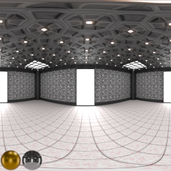</a> <b><a href="hdri-environment-maps">HDRI Environment Maps</a></b> by KillGorack · <a href="https://opengameart.org/content/hdri-environment-maps">source</a> | <a href="heavy-tankextra-low-poly-rts">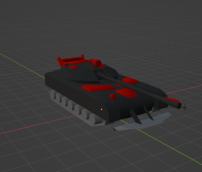</a> <b><a href="heavy-tankextra-low-poly-rts">Heavy Tank[extra low poly, RTS]</a></b> by 32kda · <a href="https://opengameart.org/content/heavy-tankextra-low-poly-rts">source</a> | <a href="home-bedroom">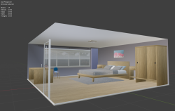</a> <b><a href="home-bedroom">Home bedroom</a></b> by DREAM_SEARCH_REPEAT · <a href="https://opengameart.org/content/home-bedroom">source</a> | <a href="home-kitchen">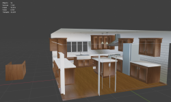</a> <b><a href="home-kitchen">home - Kitchen</a></b> by DREAM_SEARCH_REPEAT · <a href="https://opengameart.org/content/home-kitchen">source</a> |
| <a href="horror-monster-0">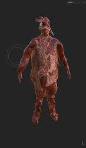</a> <b><a href="horror-monster-0">Horror Monster</a></b> by EmoPreben · <a href="https://opengameart.org/content/horror-monster-0">source</a> | <a href="human-foot-3d-model">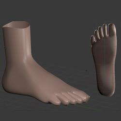</a> <b><a href="human-foot-3d-model">Human Foot 3D Model</a></b> by byzmod3d · <a href="https://opengameart.org/content/human-foot-3d-model">source</a> | <a href="humanoid-soulslike-animations">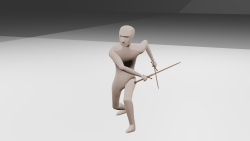</a> <b><a href="humanoid-soulslike-animations">Humanoid SoulsLike Animations</a></b> by Gres · <a href="https://opengameart.org/content/humanoid-soulslike-animations">source</a> | <a href="keith-c-mascot">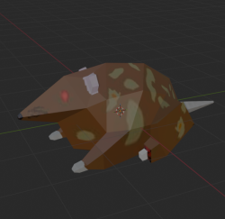</a> <b><a href="keith-c-mascot">Keith c++ mascot</a></b> by kosero4 · <a href="https://opengameart.org/content/keith-c-mascot">source</a> |
| <a href="laptop-1">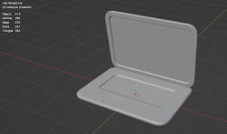</a> <b><a href="laptop-1">Laptop</a></b> by Klooverice · <a href="https://opengameart.org/content/laptop-1">source</a> | <a href="lock-1">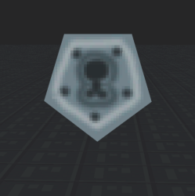</a> <b><a href="lock-1">Lock</a></b> by Q2DENJINDREW · <a href="https://opengameart.org/content/lock-1">source</a> | <a href="locomotive-1">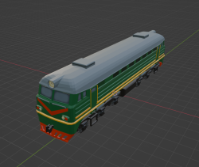</a> <b><a href="locomotive-1">Locomotive</a></b> by 32kda · <a href="https://opengameart.org/content/locomotive-1">source</a> | <a href="low-poly-animal-pack-wip">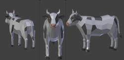</a> <b><a href="low-poly-animal-pack-wip">Low Poly Animal Pack (WIP)</a></b> by byzmod3d · <a href="https://opengameart.org/content/low-poly-animal-pack-wip">source</a> |
| <a href="low-poly-anime-girl">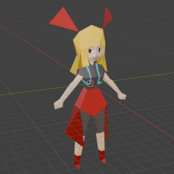</a> <b><a href="low-poly-anime-girl">Low poly anime girl</a></b> by LcohTheNerd · <a href="https://opengameart.org/content/low-poly-anime-girl">source</a> | <a href="low-poly-arena-assets">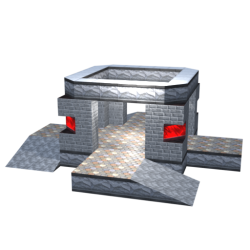</a> <b><a href="low-poly-arena-assets">Low Poly Arena Assets</a></b> by KillGorack · <a href="https://opengameart.org/content/low-poly-arena-assets">source</a> | <a href="low-poly-camping-assets">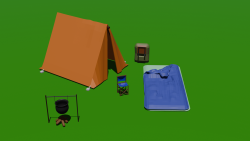</a> <b><a href="low-poly-camping-assets">Low Poly Camping Assets</a></b> by Saraskau · <a href="https://opengameart.org/content/low-poly-camping-assets">source</a> | <a href="low-poly-cave-assets">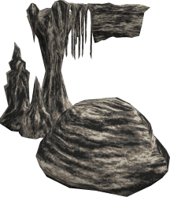</a> <b><a href="low-poly-cave-assets">Low poly cave assets</a></b> by agdg reject · <a href="https://opengameart.org/content/low-poly-cave-assets">source</a> |
| <a href="low-poly-dude-0">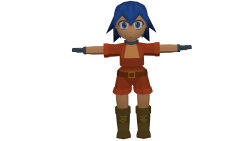</a> <b><a href="low-poly-dude-0">Low Poly dude</a></b> by konserwa · <a href="https://opengameart.org/content/low-poly-dude-0">source</a> | <a href="low-poly-iron-ore">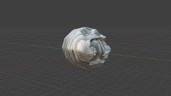</a> <b><a href="low-poly-iron-ore">low poly iron ore</a></b> by musher3004 · <a href="https://opengameart.org/content/low-poly-iron-ore">source</a> | <a href="low-poly-lighthouse-scene">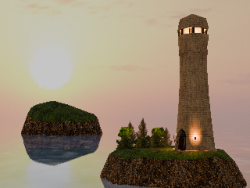</a> <b><a href="low-poly-lighthouse-scene">Low-Poly Lighthouse Scene</a></b> by ultr4vis1tor · <a href="https://opengameart.org/content/low-poly-lighthouse-scene">source</a> | <a href="low-poly-weapon-pack">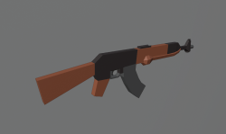</a> <b><a href="low-poly-weapon-pack">Low Poly Weapon Pack</a></b> by byzmod3d · <a href="https://opengameart.org/content/low-poly-weapon-pack">source</a> |
| <a href="lowpoly-girl">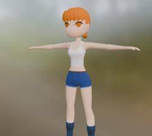</a> <b><a href="lowpoly-girl">Lowpoly girl</a></b> by konserwa · <a href="https://opengameart.org/content/lowpoly-girl">source</a> | <a href="lowpoly-shoe">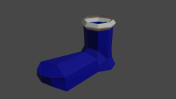</a> <b><a href="lowpoly-shoe">Lowpoly Shoe</a></b> by Lyricsz · <a href="https://opengameart.org/content/lowpoly-shoe">source</a> | <a href="lowpolyswords">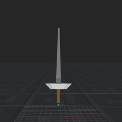</a> <b><a href="lowpolyswords">low_poly_swords</a></b> by Q2DENJINDREW · <a href="https://opengameart.org/content/lowpolyswords">source</a> | <a href="ludo-0">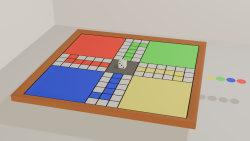</a> <b><a href="ludo-0">Ludo</a></b> by Lyricsz · <a href="https://opengameart.org/content/ludo-0">source</a> |
| <a href="medieval-castlemanor">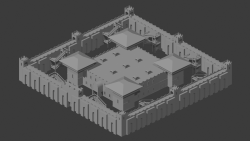</a> <b><a href="medieval-castlemanor">medieval castle/manor</a></b> by unForastero · <a href="https://opengameart.org/content/medieval-castlemanor">source</a> | <a href="medieval-dungeon-interior">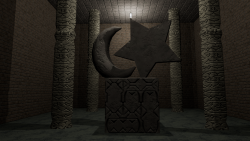</a> <b><a href="medieval-dungeon-interior">medieval dungeon interior</a></b> by cheerful sprite · <a href="https://opengameart.org/content/medieval-dungeon-interior">source</a> | <a href="mini-rocket">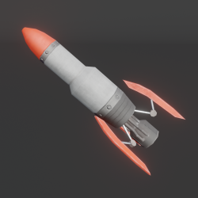</a> <b><a href="mini-rocket">Mini Rocket</a></b> by David W CG · <a href="https://opengameart.org/content/mini-rocket">source</a> |  |

---

Kept up to date by this repository's own [update workflow](.github/workflows/update.yml), with code and plan from [cc0-mirror](https://github.com/zuujis-cc0/cc0-mirror). Something wrong? [Open an issue there](https://github.com/zuujis-cc0/cc0-mirror/issues/new) or use the [private report form](https://games.zuujis.com/report).
